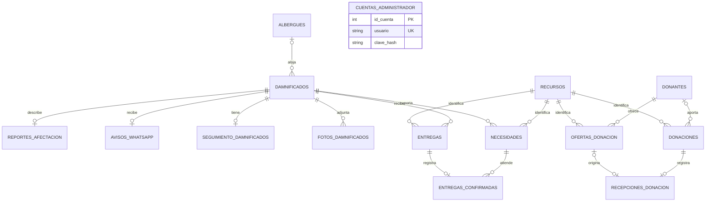

# Sistema de apoyo a damnificados

Proyecto académico de Programación IV y Calidad del Desarrollo de Software, presentado por Angela Maria Taba Bueno, Madelyn Andrea Restrepo y Isabella Rivera. El sistema registra las necesidades de las personas afectadas por un terremoto en Pereira y organiza la distribución de la ayuda.

## Instalación local

Abre PowerShell en la carpeta del proyecto con Node.js 22.13 o posterior.

```powershell
npm.cmd ci
npm.cmd start
```

Abre [el sitio local](http://127.0.0.1:3000/). El primer arranque crea `basedatos/damnificados.sqlite` y carga el catálogo inicial.

En `.env`, `PORT` indica el puerto del sitio y `DB_FILE` indica dónde se guarda la base. Si falta `.env`, puedes copiar `.env.example` con `Copy-Item .env.example .env`.

Para crear una cuenta del panel, escribe tu clave de 12 a 128 caracteres entre comillas en `ADMIN_PASSWORD` en `.env` y quita el `#` de esa línea. Ejecuta `npm.cmd run crear-admin -- administrador` y, cuando se cree la cuenta, borra la clave de `.env`. La base guarda el hash de la contraseña.

## Uso

- **Registro.** Guarda tus datos, la ayuda que necesitas y hasta tres fotos opcionales.
- **Donación.** Ofrece un recurso y deja un contacto para coordinar la entrega. Consulta **Albergues y donaciones** para ver los canales oficiales.
- **Recepción de donaciones.** En **Donaciones**, registra los aportes directos. Si ya existe una oferta, abre **Ofertas de donación**, pulsa **Confirmar recepción** e indica cuánto llegó. Cada oferta admite una confirmación.
- **Albergues.** Crea el albergue en el panel y asigna o libera un cupo desde la ficha de la persona. Cada ficha ocupa un cupo y el panel muestra cuántos quedan disponibles.
- **Entregas.** En **Necesidades**, abre **Registrar entrega** e indica la cantidad. El sistema descuenta lo entregado del inventario y actualiza el estado a **Parcial** o **Atendida**. Las ofertas empiezan a contar para el inventario al confirmar su recepción.
- **Seguimiento.** En cada ficha puedes elegir **No se pudo contactar** o **No cumple**, escribir el motivo y guardar. Si debes revisar el caso otra vez, cambia el estado a **Pendiente**.
- **WhatsApp.** Desde una ficha con teléfono válido, abre el mensaje y envíalo en WhatsApp. Luego selecciona **Confirmar envío realizado** en el panel.

## Base de datos

`basedatos/esquema.sql` es el único esquema. Define las tablas de SQLite y carga el catálogo inicial. Si tienes datos en una base anterior de MySQL, requieren una migración aparte.



Las entregas históricas cuentan para el saldo del recurso. Si una persona tiene una sola necesidad para ese recurso, también cuentan para calcular su cantidad pendiente. Cuando hay varias necesidades del mismo recurso, solo se descuenta de cada una lo que se haya registrado para esa necesidad.
